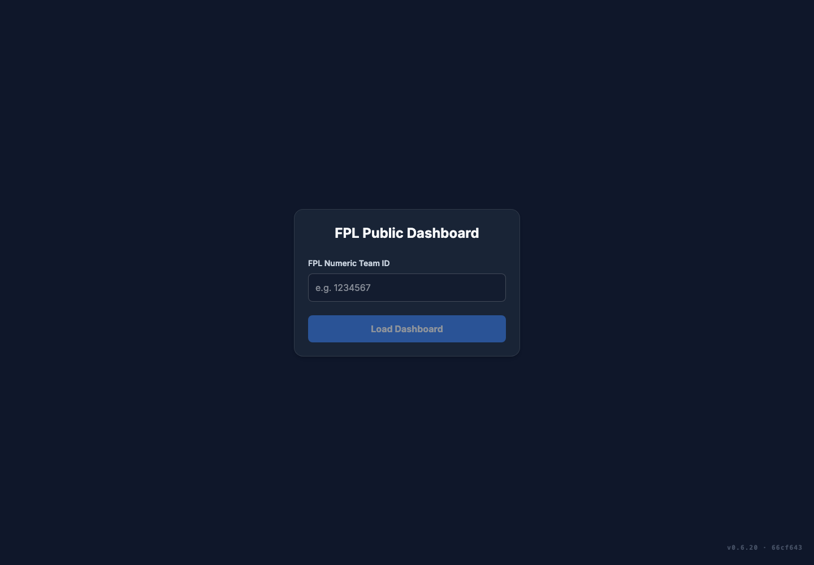

# FPL Dashboard ⚽

A planning and matchday dashboard for Fantasy Premier League managers looking to improve their overall rank.

[Live demo](https://fpl-dashboard-seven-pi.vercel.app/)



## Why I built it

I wanted to see what a transfer would mean over the next five Gameweeks, starting from the squad I actually had. I also wanted to compare a safer plan with a higher-upside one and see where the extra risk came from.

## What it does

- Compare five-Gameweek Floor, Balanced, and Upside plans with transfers, hits, lineups, captaincy, and projected points.
- Lock players, exclude transfer targets, cap hits, and reserve money in the bank.
- Import and review your current Pick Team squad before the deadline, then save a plan and evaluate it against finalized results.
- Track live squad points, rank, fixtures, and mini-league standings.

## Tech & design choices

The app uses Next.js, React, TypeScript, Supabase/Postgres, and Recharts. Vercel hosts the production deployment.

- Official FPL endpoints provide the published baseline. A user-invoked bookmarklet can read the pre-deadline squad in a signed-in FPL browser and send only the planning fields. The dashboard never receives the FPL credentials or submits squad changes.
- Supabase stores immutable planning snapshots so a saved recommendation can be evaluated against the inputs that produced it.
- The scenario generator enforces FPL squad and budget rules. When the objectives converge on the same moves, the workspace shows a single recommendation with a range of outcomes.

See the [as-built architecture](docs/redesign/AS_BUILT_ARCHITECTURE_2026-27.md) and [launch runbook](docs/operations/2026-27-launch-runbook.md) for details.

## Run locally

Configure `NEXT_PUBLIC_SUPABASE_URL`, `NEXT_PUBLIC_SUPABASE_ANON_KEY`, and the server-only `SUPABASE_SERVICE_ROLE_KEY` in `.env.local`. Apply the migrations in [supabase/migrations](supabase/migrations) to your development database.

```bash
npm ci
npm run dev
```

Open <http://localhost:3000>. The planning workspace is at `/planning`.

## What I'd do next

Keep the last valid planning snapshot available during upstream outages, calibrate projections against finalized results, and model when to play chips.
