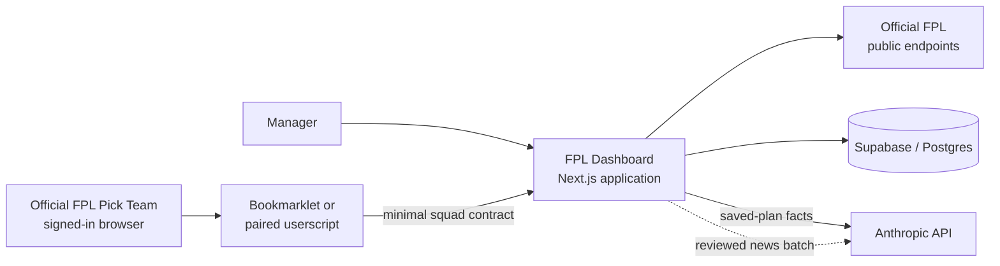
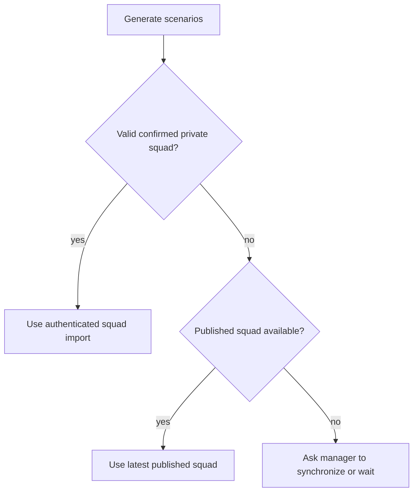
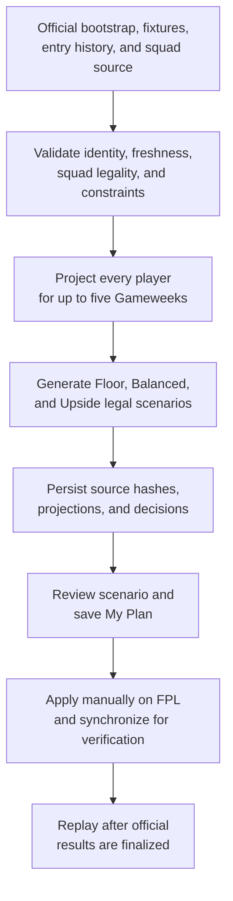

# FPL Dashboard system documentation

Status: Current implementation reference  
Application version: `0.6.20`  
Updated: 2026-11-19

## 1. Purpose and scope

FPL Dashboard is a read-only decision-support application for Fantasy Premier League managers. It combines official FPL data, a manager's current squad, a deterministic projection model, and a legal scenario generator to recommend transfers, weekly lineups, captaincy, bench order, and selected chip opportunities.

The dashboard does not submit transfers, lineup changes, captaincy changes, or chips to the official FPL account. The manager reviews the recommendation, makes the changes on FPL, and can then synchronize the squad back to the dashboard for verification.

This document is the technical source of truth for the current implementation. Historical product decisions remain in `docs/redesign/` and operational procedures remain in `docs/operations/`.

## 2. Capability status

| Capability | Status | Notes |
| --- | --- | --- |
| Public dashboard and live Gameweek data | Implemented | Uses official public FPL endpoints. |
| Five-Gameweek Floor, Balanced, and Upside scenarios | Implemented | Deterministic model and legal squad rules. |
| Private pre-deadline squad import | Implemented | Bookmarklet or paired browser userscript. |
| Transfer, lineup, captain, vice-captain, and bench verification | Implemented | Compares a new squad sync with the saved plan. |
| Remaining free-transfer awareness | Implemented | Derived from the authenticated FPL squad payload. |
| My Plan persistence and deadline lifecycle | Implemented | Saved decisions reference immutable planning snapshots. |
| Sonnet plan explanation | Implemented, optional | On demand, validated, cached, and attributed in the UI. |
| Curated Haiku team-news extraction | Pilot | Manual reviewed input batch, exact evidence, no automatic plan adjustment. |
| Bench Boost and Triple Captain opportunity guidance | Implemented, advisory | Evaluates the visible horizon within the applicable half-season. |
| Planning backtest and chip replay | Implemented | Runs after FPL marks a Gameweek finished and data-checked. |
| Automatic writes to FPL | Not supported | Deliberate security and product boundary. |
| Full Wildcard and Free Hit squad planning | Planned | Not generated by the current scenario engine. |
| Automatic team-news collection | Planned | Current pilot requires a reviewed batch. |

## 3. System context



### Main runtime components

- **Next.js and React** provide pages, route handlers, and server-side application logic.
- **Official FPL endpoints** provide bootstrap data, fixtures, published picks, entry history, and finalized player results.
- **Supabase/Postgres** stores sessions, confirmed squad imports, reproducible planning snapshots, saved plans, sync tokens, AI explanations, and team-news batches.
- **Anthropic** provides optional natural-language explanation and evidence extraction. It is not part of the numerical optimizer.
- **Vercel** hosts the production application. GitHub Actions and production smoke tests provide release checks.

## 4. Identity and sessions

The user signs in with a numeric FPL entry ID. In a configured environment, the server creates a random session token, stores only its SHA-256 hash in `fpl_sessions`, and sets the raw token in an HTTP-only cookie. The entry ID is resolved server-side for protected requests.

When all Supabase environment variables are absent in development, the application uses an in-memory session store. This fallback is intended for local public-dashboard development. It is cleared when the development process restarts and does not provide persistent Planning storage.

## 5. FPL data sources and lifecycle

Planning distinguishes two concepts:

- **Planning Gameweek** is the next Gameweek whose deadline has not passed, or the current applicable event selected from bootstrap lifecycle fields.
- **Published squad Gameweek** is the most recent Gameweek for which the manager's picks are public.

Before a deadline, public endpoints do not reveal unfinalized squad changes. The application therefore uses the following precedence:



A confirmed import remains valid until two hours after the selected planning deadline. After public picks become available, the published squad can become the next planning baseline.

## 6. Authenticated squad synchronization

### 6.1 Manual bookmarklet

The manager opens the official FPL Pick Team page while signed in and deliberately invokes the dashboard bookmark. Code running on the FPL origin calls FPL's same-origin `/api/me/` and `/api/my-team/{entry}/` endpoints. It reduces the response to the versioned import contract and opens the dashboard import page with the encoded contract in a URL fragment.

The fragment is not sent in the initial HTTP navigation. The import page reads it locally, clears it, resolves public player metadata, and asks the manager to confirm the 15-player squad before persistence.

### 6.2 Paired userscript

The optional userscript uses a private, revocable pairing token. It runs on the signed-in FPL page and submits the same minimized contract directly to `/api/v1/planning/sync`.

The sync route enforces all of the following:

- exact origin `https://fantasy.premierleague.com`
- valid bearer pairing token
- token entry ID matching the imported entry ID
- strict import schema
- current FPL player catalogue membership
- squad composition, club limit, and formation legality
- import freshness and current deadline

Creating a replacement userscript revokes earlier pairings for the entry. Pairing tokens are stored hashed and expire.

### 6.3 Import contract v1

The contract permits only:

- schema version, source identifier, entry ID, and capture time
- active chip
- 15 player IDs, lineup positions, purchase and selling prices, multipliers, captain, and vice-captain flags
- bank, squad value, transfer allowance, transfers already made, transfer cost, and status

Unexpected fields are rejected. Passwords, FPL cookies, bearer credentials, CSRF material, email addresses, and the raw upstream response are not part of the contract.

### 6.4 Refresh and check semantics

- **Refresh squad** opens the import workflow. The manager must rerun the bookmarklet or allow the userscript to send a new squad.
- **Check latest sync** does not contact FPL. It loads the most recently stored confirmed squad and compares it with My Plan.
- An automatic userscript sync occurs when its script runs on the FPL Pick Team page. The dashboard can only see that update after it has been received and stored.

## 7. Planning pipeline



### Planning constraints

The current API accepts:

- locked player IDs
- excluded incoming player IDs
- maximum points hit from 0 to 20
- bank reserve from £0.0m to £20.0m

The UI currently asks the user to enter FPL player IDs as comma-separated values.

## 8. Projection model

The current numerical model is `fpl-internal-v2`. It is intentionally simple and deterministic.

For each player and Gameweek, it combines:

- official next-event expected points when available for the first projected week
- recent FPL form as the fallback baseline
- fixture difficulty
- multiple fixtures in the same Gameweek
- availability or chance-of-playing information

The implementation derives a start probability, weekly expected points, a horizon total, uncertainty, floor, and ceiling. Floor and ceiling are model ranges, not statistical confidence intervals.

Important limitations:

- it does not ingest betting markets, expected-goals feeds, predicted lineups, or proprietary minute forecasts
- fixture difficulty is an official coarse rating
- form and official expected points are lightweight inputs
- future price changes are not modeled
- projections are not yet calibrated against a large historical error dataset
- team news is displayed alongside the plan but does not currently modify expected minutes automatically

## 9. Scenario generator

The scenario model version is based on `fpl-internal-v2-weekly-xi-v2`, with a chip suffix when chip advice is available.

### Legal rules

The generator enforces:

- exactly 15 players
- matching positions for a transfer
- no duplicate player
- no more than three players from one club
- budget and configured bank reserve
- locked and excluded players
- maximum transfer hit
- legal starting formations with one goalkeeper, three to five defenders, two to five midfielders, and one to three forwards

### Transfer selection

The engine considers same-position replacements and ranks them by the scenario objective. It can make up to five transfers within the free-transfer and hit constraint. A proposed step is retained only when the projected five-Gameweek score after the hit is better than the prior forecast.

The first transfer can be accepted with any positive objective gain. Additional transfers require more than four objective points before the full lineup forecast is recomputed. The scenario also reports its projected gain against holding the initial squad.

For an authenticated import, remaining free transfers are calculated from FPL's total allowance minus transfers already made. Unlimited transfer status produces no modeled hit. When only public picks are available, the current fallback assumes one free transfer because private transfer state is unavailable.

### Weekly lineup and captaincy

Transfers are evaluated over the horizon, but the displayed starting XI, captain, vice captain, and bench order are selected from the first projected Gameweek. Each horizon week's total is calculated with a fresh legal weekly XI and captain.

The captain is the highest-scoring starter for the scenario objective in that week, and the vice captain is second. The outfield bench is ordered by projected weekly value. The reserve goalkeeper remains in the goalkeeper bench slot.

### Scenario objectives

- **Floor** ranks players by the model floor and favors availability and dependable minutes.
- **Balanced** ranks by expected five-Gameweek total.
- **Upside** ranks by the model ceiling and accepts more uncertainty.

If all three objectives produce the same move, lineup, and captain, the UI presents the result as a robust recommendation rather than fabricating different answers.

## 10. My Plan and verification

Each generated scenario is associated with content-hashed source snapshots, projections, constraints, model version, and decisions. Saving My Plan appends a selection that references the persisted scenario. It does not change the official FPL account.

The Review on FPL panel provides:

- exact transfer instructions and expected hit
- projected remaining bank
- starting XI
- captain and vice captain
- ordered bench
- optional chip instruction
- links to official Transfers and Pick Team pages
- a copyable checklist

After another squad synchronization, verification separately compares:

- transfer result or resulting squad
- complete 15-player squad
- starting XI membership
- captain
- vice captain
- bench order, including the reserve goalkeeper position

`Matches plan` means the latest stored squad agrees with that part of My Plan. `Pending` means it does not agree or no newer confirmed sync is available. It does not mean the dashboard has submitted a change.

## 11. Chip opportunity guidance

The Balanced scenario can include advisory calculations for Bench Boost and Triple Captain. Chip use history is read from the public FPL entry history, while an active pre-deadline chip can come from the authenticated squad import.

The implementation treats Gameweeks 1–19 and 20–38 as separate chip-copy windows. It reports the applicable expiration deadline and evaluates up to the five Gameweeks currently visible within that half-season.

- **Bench Boost value** is the projected sum of the four non-starting players for that Gameweek.
- **Triple Captain incremental value** is an additional captain score, with a vice-captain fallback weighted by the captain's non-start probability.

A chip is suggested only when it is unused in the current half, no other chip is active, the best visible opportunity is the current Gameweek, and its estimated value is positive. This is a horizon comparison, not a guarantee that no stronger opportunity exists beyond the five visible Gameweeks.

Wildcard and Free Hit appear in replay labels when actually used, but the current planner does not generate a new squad optimized for those chips.

## 12. AI-assisted features

AI features are optional augmentations. They do not replace the deterministic projection and scenario engine.

### 12.1 Saved-plan explanation

The user explicitly selects **Explain this plan** after saving a scenario. The server loads only saved plan facts and recorded projections, constructs legal lineup comparisons, and calls `Claude Sonnet 5.5` using a structured JSON output schema.

The prompt requires the model to use supplied facts only and prohibits invented fixtures, injuries, reasons, differences, or chip advice. The returned explanation is validated, limited in size, attributed in the UI, and cached by scenario and prompt/model version. Concurrent requests for the same scenario share an in-flight request.

### 12.2 Curated Team News pilot

An operator prepares a reviewed JSON batch containing:

- the exact Gameweek deadline
- one to 30 FPL player IDs and names
- one to 30 HTTPS sources
- publication timestamps with timezones
- short source excerpts

`Claude Haiku 5.5` classifies each player into a restricted availability or role signal and must cite exact text from the supplied excerpts. Application validation rejects evidence not found verbatim in its referenced excerpt, unexpected players, invalid signals, post-deadline sources, and malformed timestamps.

A content hash provides deterministic deduplication. A dry run invokes the model without writing. A published batch is stored and the Planning UI filters it to current squad members and suggested transfer players. The UI displays model attribution, source links, publication times, and processing time.

The pilot is not a web crawler and does not automatically alter projections. Source selection, excerpt accuracy, and final publication remain human-reviewed responsibilities.

### 12.3 Cost and observability

Anthropic usage depends on prompt size and current provider pricing. The application logs token counts for plan explanations, while the team-news script prints input and output token usage. Cached explanation and duplicate news requests avoid repeat model calls.

Provider prices and model behavior can change. Cost estimates should be calculated from actual logged token use and current official Anthropic pricing rather than hard-coded in product documentation.

## 13. Backtest and replay

The home-page Planning backtest finds the latest event for which FPL reports both `finished` and `data_checked`. It then loads the latest pre-deadline Balanced recommendation generated with default constraints for that entry and season.

The replay uses official final player points and appearance evidence. It applies:

- the recorded legal starting XI
- FPL-compatible automatic substitutions while preserving formation
- goalkeeper-for-goalkeeper substitution rules
- captain fallback to vice captain
- Bench Boost or Triple Captain scoring
- recorded and already-paid transfer hits

The result compares actual gross and net points with the hypothetical planned gross and net points. If a scoring chip was advised but not recorded as active, it also replays the plan with and without that chip to show the realized opportunity.

Possible states are:

- no finalized Gameweek
- no recorded pre-deadline recommendation
- incomplete official player results
- ready comparison

The backtest evaluates a recorded opportunity. It does not prove that a projection model is generally accurate from one Gameweek, and it must not use a recommendation generated after the deadline.

## 14. Persistence model

| Table | Purpose |
| --- | --- |
| `fpl_sessions` | Hashed dashboard session tokens mapped to FPL entry IDs. |
| `seasons` | Season identity used to prevent cross-season collisions. |
| `fpl_snapshots` | Content-addressed global FPL source snapshots. |
| `entry_snapshots` | Entry-specific squad and transfer source records. |
| `planning_scenarios` | Immutable projections, constraints, model version, and decisions. |
| `planning_plan_selections` | Append-only My Plan selections and outcome lifecycle. |
| `confirmed_squad_imports` | Latest confirmed private squad for an entry. |
| `fpl_sync_tokens` | Hashed, revocable browser pairing tokens. |
| `planning_explanations` | Cached explanation by scenario and prompt/model version. |
| `planning_team_news` | Deduplicated processed news batch and verified signals. |

All sensitive planning tables use row-level security that denies anonymous access. Server-side service-role code performs persistence operations.

Migrations are additive and live under `supabase/migrations/`. A fresh project must apply `supabase/schema.sql` and then migrations in filename order. The service-role grant migration is required because fresh local Supabase projects may not include the expected table grants.

## 15. Planning API reference

All paths are under `/api/v1`.

| Method and path | Purpose | Access |
| --- | --- | --- |
| `POST /planning/scenarios` | Build, persist, and return scenarios. | Dashboard session, feature flag in production. |
| `GET /planning/plans` | Load the latest saved plan. | Dashboard session. |
| `POST /planning/plans` | Save a persisted scenario as My Plan. | Dashboard session. |
| `GET /planning/import` | Load the latest confirmed squad. | Dashboard session. |
| `POST /planning/import` | Validate and save a reviewed squad. | Dashboard session. |
| `DELETE /planning/import` | Clear the saved confirmed squad. | Dashboard session. |
| `GET /planning/import-contract` | Publish the supported import contract metadata. | Public. |
| `POST /planning/sync-token` | Revoke old pairing and create a private sync token. | Dashboard session. |
| `DELETE /planning/sync-token` | Revoke active pairing tokens. | Dashboard session. |
| `OPTIONS, POST /planning/sync` | Receive a paired userscript squad sync. | FPL origin plus bearer pairing. |
| `GET /planning/player-catalog` | Resolve public FPL player metadata for review. | Public catalogue. |
| `POST /planning/explanation` | Generate or load a cached saved-plan explanation. | Dashboard session and Anthropic configuration. |
| `GET /planning/team-news` | Load the latest applicable stored news batch. | Dashboard session. |
| `GET /planning/backtest` | Replay the latest finalized recorded recommendation. | Dashboard session. |

The application also exposes public-dashboard routes for summary, live squad, transfers, fixtures, leagues, rank projection, and health. Their detailed behavior remains covered by the route handlers and tests.

## 16. Configuration

### Required for persistent production operation

| Variable | Purpose |
| --- | --- |
| `NEXT_PUBLIC_SUPABASE_URL` | Supabase project URL. |
| `NEXT_PUBLIC_SUPABASE_ANON_KEY` | Supabase public client key. |
| `SUPABASE_SERVICE_ROLE_KEY` | Server-only persistence key. |
| `PLANNING_WORKSPACE_V1=true` | Enables Planning routes in production. |
| `CRON_SECRET` | Protects the scheduled evaluation route. |

### Optional capabilities

| Variable | Purpose |
| --- | --- |
| `ANTHROPIC_API_KEY` | Enables plan explanations and the team-news publication tool. |
| `KV_REST_API_URL` | Upstash Redis REST endpoint for shared rate limiting. |
| `KV_REST_API_TOKEN` | Upstash Redis credential for shared rate limiting. |

`.env.local` must not be committed. Never place API keys, service-role keys, browser pairing tokens, or FPL session material in documentation, screenshots, fixtures, logs, or client-side environment variables.

## 17. Local development

```bash
npm ci
npm run dev
```

Public dashboard development can use the in-memory session fallback. Persistent Planning requires a Supabase development project. The README contains the current local Supabase bootstrap commands.

After configuration, verify:

1. `/api/v1/health` reports database and FPL upstream readiness.
2. Sign-in creates a dashboard session.
3. The import flow accepts and confirms a legal 15-player squad.
4. Planning generates three scenarios.
5. My Plan survives a page reload.
6. A new sync can verify squad, XI, captaincy, and bench order.

Publish a reviewed team-news batch with:

```bash
node --env-file=.env.local scripts/publish-team-news.mjs /path/to/batch.json --dry-run
node --env-file=.env.local scripts/publish-team-news.mjs /path/to/batch.json
```

## 18. Testing and operations

Primary commands:

```bash
npm run lint
npm run test
npx tsc --noEmit
npm run build
npm run test:e2e:smoke
npm run test:smoke -- https://fpl-dashboard-seven-pi.vercel.app
```

Tests cover the projection model, legal scenario generation, weekly XI behavior, import validation, synchronization, persistence, explanations, chip advice, replay, backtest states, and Planning UI interactions.

Before a deadline, an operator should verify health, release identity, squad synchronization, Planning generation, My Plan handoff, and source freshness. Avoid non-critical production deployments during the final hour before the deadline. See `docs/operations/2026-27-launch-runbook.md` for the operational checklist.

## 19. Failure and recovery behavior

- **FPL public API failure**: the current request reports unavailability. A future enhancement is to preserve and label the last valid planning snapshot.
- **Confirmed import store failure**: scenario generation can fall back to a request-provided same-tab import or published picks where available.
- **Supabase scenario persistence failure**: scenarios can be returned with `reproducibility: degraded`, but they cannot safely become a persisted My Plan.
- **Anthropic unavailable**: the deterministic plan remains usable. Explanation or team-news processing reports an error without changing the plan.
- **Old or incorrect private squad**: rerun the bookmarklet or userscript, confirm the new squad, and regenerate.
- **Compromised pairing**: create a replacement script or revoke the sync token.

## 20. Implemented work inventory

The current development cycle added or completed:

1. A local development session fallback when Supabase is intentionally absent.
2. Fresh local Supabase bootstrap support and explicit `service_role` grants.
3. Private squad import through a minimized bookmarklet contract.
4. Optional paired userscript synchronization with revocable tokens and FPL-origin CORS.
5. Correct interpretation of FPL transfer allowance as total allowance minus transfers already made.
6. Weekly starting-XI, captaincy, and bench selection separated from the five-Gameweek transfer horizon.
7. Transfer-versus-hold scoring, with transfer hits applied once across the horizon.
8. Rejection of transfer sequences that do not improve the legal horizon forecast after hits.
9. My Plan handoff with transfer, XI, captain, vice, bench, official-page links, and copyable checklist.
10. Latest-sync verification for squad, transfer result, XI, captain, vice captain, and detailed bench order.
11. Sonnet saved-plan explanations with structured output, validation, attribution, caching, and usage logging.
12. Curated Haiku team-news extraction with exact-evidence validation, source timestamps, deduplication, and UI attribution.
13. Bench Boost and Triple Captain opportunity calculations for first-half and second-half chip copies.
14. Finalized-Gameweek backtesting with legal auto-subs, captain fallback, transfer hits, and chip opportunity replay.
15. Expanded unit and component coverage for the planning, sync, AI, chip, and replay paths.

## 21. Known limitations and recommended next work

1. Calibrate projected minutes and points against finalized results by position, horizon, and availability status.
2. Add a safe, reviewed team-news collection scheduler with source quality and staleness policies.
3. Run the first real backtest after the next recorded Gameweek becomes both finished and data-checked.
4. Model the option value of rolling a free transfer instead of always seeking an immediate positive move.
5. Extend chip planning to the full half-season and account for blank and double Gameweeks.
6. Add explicit Wildcard and Free Hit squad-generation modes.
7. Add historical model-quality dashboards rather than relying on a single opportunity replay.
8. Preserve and label the last valid planning snapshot during upstream outages.
9. Complete release validation and reconcile the deployed version with this implementation.

## 22. Related documentation

- `README.md` — repository entry point and local setup
- `docs/USER_GUIDE.md` — manager-facing instructions
- `docs/redesign/PRODUCT_SPEC.md` — original V1 product specification
- `docs/redesign/AS_BUILT_ARCHITECTURE_2026-27.md` — historical launch-baseline architecture
- `docs/redesign/adr/` — architectural decisions
- `docs/operations/2026-27-launch-runbook.md` — deadline and release operations
- `docs/testing/` — testing strategy and handbooks

